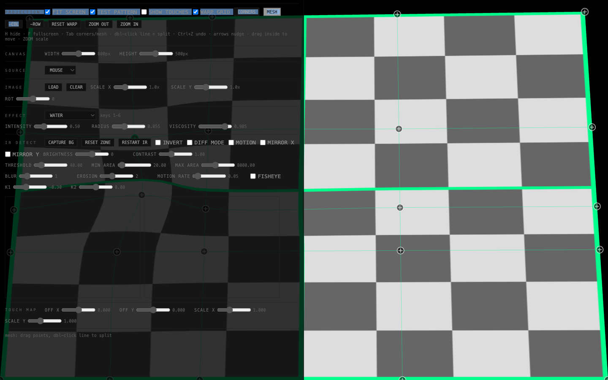

# Videoplaster

**English** · [Español](./README.es.md)

Interactive projection-mapping installation: media is warped onto a physical surface and reacts to touch, detected with an IR-sensitive webcam. Touches also stream out as TUIO for other software.



## Overview

Videoplaster projects video/images/GPU effects onto a physical relief and turns that surface into a touch screen:

1. **Calibrate the projection** with a two-layer warp: a 4-corner perspective fit plus a Photoshop-style detail mesh you can subdivide exactly where the surface needs it.
2. **Detect touches** with a webcam whose IR-cut filter has been removed, watching the surface under IR illumination — fingertips read as bright blobs.
3. **React**: touches drive the active GPU effect (water, ink, thermal, …) and are emitted as TUIO 1.1 (UDP :3333) for TouchDesigner, Resolume, or anything else.

## Hardware

- A projector.
- A **webcam with the IR-cut filter manually removed** (add an IR-pass filter to block visible projector light), pointed at the surface.
- IR illumination (e.g. 850 nm floodlight) so fingers reflect brightly.
- macOS tested; the web app itself is cross-platform.

No proprietary tracking hardware — the only inputs are a modified webcam or the mouse.

## Quick start

```bash
npm install
npm run dev        # → http://localhost:8000  (MOUSE source works with no hardware)
```

Optional — TUIO output (Python bridge):

```bash
./setup.sh         # once: .venv with websockets + python-osc
./run.sh           # TUIO bridge + Vite together
```

## Calibration guide

Press `H` to hide the panel while dragging on the canvas.

1. **CORNERS** (default mode): drag the 4 corner handles until the projected quad sits on your surface — the perspective fit. Drag anywhere inside the quad to move everything; `ZOOM IN/OUT` scales it.
2. **MESH** (`Tab` or the MESH button): drag mesh points to bend the image into the surface relief. **Double-click any mesh line to split it right there** — add columns/rows only where you need detail (spacing can be non-uniform). `−COL` / `−ROW` remove the selected point's line. Moving a corner later does not break mesh detail — the mesh rides on the perspective layer.
3. **TEST PATTERN**: projects a checkerboard through the warp so you see exactly how media will land. Calibrate until the pattern hugs the surface.
4. **IR DETECT**: select the CAMERA source, then tune THRESHOLD / MIN–MAX AREA / BLUR / EROSION watching the two previews (processed frame + binary mask). Drag the ROI corners on the preview to limit detection to the surface. CAPTURE BG subtracts the static background.
5. **TOUCH MAP**: fine-tune OFF X/Y and SCALE X/Y so touches align with the projected content.
6. **SHOW TOUCHES**: draws a crosshair at each touch's warped position — end-to-end verification. (Uncheck WARP GRID when testing with the mouse so clicks pass through as touches.)
7. `Ctrl+Z` / `Ctrl+Shift+Z` undo/redo warp edits. `RESET WARP` resets only the active layer.

All settings persist in `localStorage` (`vp_settings`).

## Sources

| Source | What it is |
|---|---|
| MOUSE | Mouse/trackpad as fake touch — develop with no hardware. |
| CAMERA | getUserMedia webcam → IR blob-detection pipeline → touches. |

## Effects

Keys `1`–`6` switch effects; each exposes its own sliders.

WATER · INK BLOOM · EROSION REVEAL · THERMAL HEAT · SHATTER GLASS · PARTICLE CHAOS

## Keys

| Key | Action |
|---|---|
| `H` | hide/show the control panel |
| `F` | fullscreen |
| `Esc` | show the panel |
| `Tab` | CORNERS ↔ MESH mode |
| double-click a mesh line | insert a column/row there |
| `Ctrl+Z` / `Ctrl+Shift+Z` | undo / redo warp edits |
| arrows (`Shift` = ×10) | nudge the selected handle |
| `1`–`6` | switch effect |

## TUIO output

Every touch (any source) is sent over WebSocket to `ws://localhost:7681`; the Python bridge (`bridge/tuio-bridge.py`) relays it as TUIO 1.1 `/tuio/2Dcur` on UDP `127.0.0.1:3333`. The bridge is optional — without it the app still works, you just lose TUIO.

## Standalone macOS app (Tauri)

```bash
./scripts/build-bridge.sh   # freeze the TUIO bridge into a sidecar binary
npm run tauri:build         # or tauri:dev
```

The Tauri shell opens a kiosk window and manages the bridge sidecar automatically. Camera permission is declared in `Info.plist` / entitlements.

## Development

```bash
npm test            # typecheck + unit tests (node --test)
npm run typecheck
```

See [DEVELOPMENT.md](DEVELOPMENT.md) for architecture details.

## Troubleshooting

- **Camera list is empty** — grant camera permission (macOS: System Settings → Privacy & Security → Camera), then reselect CAMERA.
- **No touches detected** — check the mask preview: fingertips must appear as white blobs. More IR light, lower THRESHOLD, or adjust the ROI. Try CAPTURE BG with the surface empty.
- **Touches misaligned** — verify with SHOW TOUCHES; correct with TOUCH MAP.
- **No TUIO arriving** — is the bridge running (`./run.sh` or the Tauri sidecar)? It prints `WS :7681  TUIO -> 127.0.0.1:3333` on boot.

## Technology

Vite + vanilla TypeScript · WebGL1 (warp + effects) · Canvas 2D (overlays) · getUserMedia · Python 3 (websockets + python-osc) for the TUIO relay · Tauri v2 for the desktop build.
